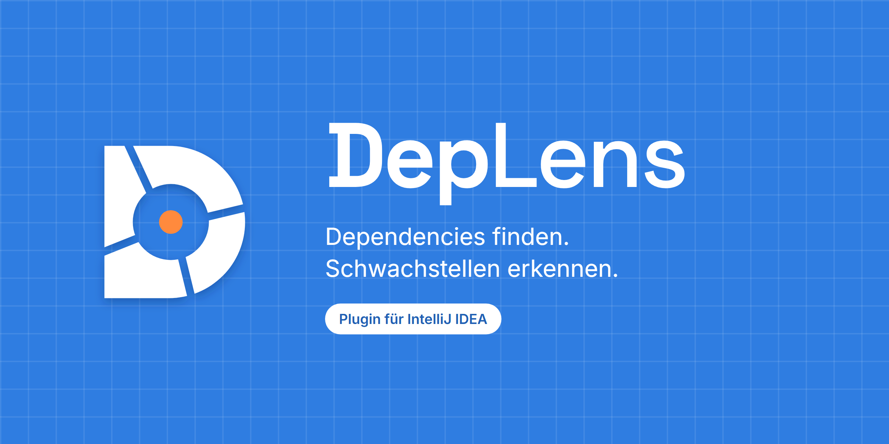

  

# DepLens

IntelliJ-Plugin zum Durchsuchen von Gradle-Dependencies pro Modul.
Die Dependencies erscheinen nach Hersteller gruppiert (Spring, Jackson, …). Für eine gewählte Dependency
zeigt DepLens alle Wege, über die sie reinkommt, und was sie mitbringt. Fehlen Daten, startet DepLens
selbst einen Gradle-Sync.

## Voraussetzungen

- IntelliJ IDEA 2026.2+
- JDK 25

## Entwickeln

| Befehl | Zweck |
|---|---|
| `./gradlew test` | Unit-Tests |
| `./gradlew runIde` | Sandbox-IDE mit Plugin starten (zum Testen `samples/demo` öffnen) |
| `./gradlew buildPlugin` | Installierbares ZIP unter `build/distributions/` |

Installation: *Settings → Plugins → ⚙ → Install Plugin from Disk…* und das ZIP wählen.

## Sicherheitsprüfung

DepLens prüft jede Dependency automatisch gegen [OSV.dev](https://osv.dev) und liest die verfügbaren
Versionen von Maven Central. In der Liste steht ⛔ (mit Anzahl der Lücken), ✔ (keine bekannten Lücken)
oder `?` (nicht prüfbar). Im Tab „Sicherheit“ stehen die Lücken mit Schweregrad, Link und
„behoben in“ sowie zwei Upgrade-Vorschläge: die nächste sichere Version mit gleicher Major und die
neueste sichere Version.

- Ergebnisse werden 24 h zwischengespeichert; das Neu-prüfen-Icon (Sicherheit neu prüfen) prüft neu.
- „Nur verwundbare“ blendet alle sicheren Dependencies aus.
- Gesendet werden nur Koordinaten (`group:artifact[:version]`).
- *Settings → Tools → DepLens*: Prüfung an/aus, Cache-Dauer, optional Sonatype OSS Index
  (Benutzer + API-Token, Token im IntelliJ-Passwortspeicher).

## Datenquelle

DepLens nutzt IntelliJs eingebauten Gradle-Dependency-Analyzer
(`DependencyAnalyzerContributor`). Pro Knoten ist nur die aufgelöste Version bekannt;
Versionskonflikte erscheinen als ⚠ mit der konkurrierenden Version.

## Logo & Icons

  <picture>
    <source media="(prefers-color-scheme: dark)" srcset="docs/assets/deplens-logo-dark.png">
    
  </picture>

| Datei | Verwendung |
|---|---|
| `docs/assets/deplens-icon.svg` | App-Icon (512 × 512) |
| `src/main/resources/META-INF/pluginIcon.svg` | Plugin-Icon in IntelliJ und im Marketplace |
| `docs/assets/deplens-logo.png` / `deplens-logo-dark.png` | Logo horizontal, hell / dunkel |
| `docs/assets/deplens-banner.png` | Banner für Marketplace und GitHub (1280 × 640, @2x) |
